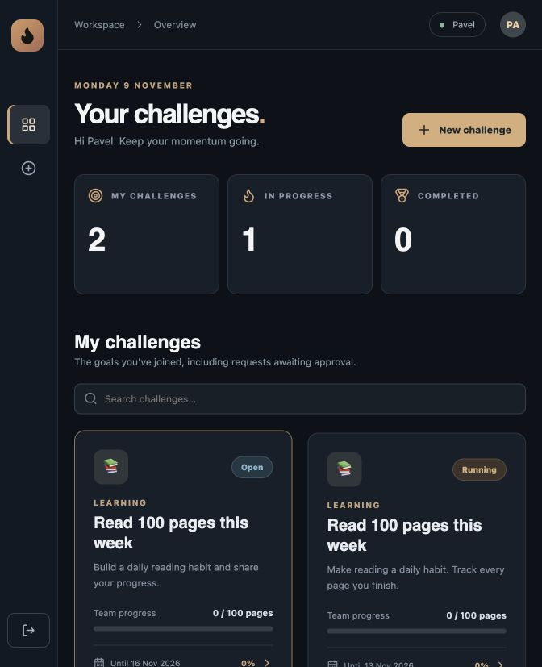

# ChallengeTracker

Školní projekt pro sledování krátkodobých výzev. Uživatel vytvoří výzvu, ostatní se připojí a zapisují denní pokrok. Výsledky se zobrazují v žebříčku.

Backend používá ASP.NET Core 10, EF Core a SQLite. Frontend je v Reactu 19 a TypeScriptu.



## Spuštění

Potřebné nástroje: .NET 10 SDK, Node.js 22+ a npm.

```bash
git clone https://github.com/pavlis29/wbs-coding-school.git
cd wbs-coding-school/ChallengeTracker
./start.sh
```

Aplikace běží na **http://localhost:5173**, API na **http://localhost:5080**. Při prvním spuštění se nainstalují závislosti a vytvoří databáze. Servery se ukončují pomocí Ctrl+C.

Na přihlašovací stránce lze vytvořit účet. Heslo musí mít alespoň 8 znaků, velké a malé písmeno, číslici a speciální znak.

Pokud jsou porty obsazené:

```bash
API_PORT=5082 FRONTEND_PORT=5174 ./start.sh
```

## Funkce

- Vytvoření, zobrazení, úprava a smazání výzvy.
- Veřejné výzvy s okamžitým členstvím a soukromé výzvy se schválením vlastníkem.
- Přechody stavů Open → Running → Completed.
- Jeden zápis pokroku na uživatele, výzvu a UTC den.
- Úprava vlastního zápisu do 24 hodin; smazání bez časového limitu.
- Žebříček počítaný ze zapsaného pokroku.

## Struktura projektu

| Složka | Obsah |
| --- | --- |
| `api/ChallengeTrackerApi/` | API, služby, modely a databázové migrace |
| `api/ChallengeTrackerApi.Tests/` | Unit a integrační testy |
| `frontend/src/` | Stránky, komponenty, přihlášení a práce s API |
| `docs/` | Popis aplikace, endpointy a testování |
| `scripts/` | Kontrola projektu a konfigurace Dockeru |

## Data a konfigurace

Lokální databáze je v `.local/challenge.db`, log API v `.local/api.log`. Soubor `.local/backend.env` obsahuje vygenerovaný JWT klíč a heslo vývojových účtů `pavel@example.test` a `alex@example.test`. Tyto soubory jsou v `.gitignore`.

Při samostatném spuštění backendu lze nastavit `Database__Provider`, `ConnectionStrings__DefaultConnection`, `Jwt__Key` a `Cors__AllowedOrigins__0`. JWT klíč musí mít alespoň 32 bajtů. Frontend používá `VITE_API_BASE_URL`, bez prefixu `/api`.

Dokumentace API je ve vývojovém režimu na **/scalar/v1**, OpenAPI na **/openapi/v1.json**. Stav aplikace kontrolují **/health**, **/health/live** a **/health/ready**.

## Testy

Po instalaci závislostí:

```bash
./scripts/check.sh
```

Skript spustí backendové testy a sestavení frontendu. Při ověření 9. 11. 2026 prošlo všech 43 testů. Podrobnosti jsou v [test reportu](docs/TEST_REPORT.md).

## Docker

Konfigurace pro API a SQL Server je připravená, ale běh se SQL Serverem zatím nebyl otestován.

```bash
./scripts/configure-docker.sh
docker compose up --build -d
```

Skript vytvoří lokální `.env`. Compose spustí databázi, provede migrace a poté spustí API na portu 5080. Frontend se spouští zvlášť:

```bash
cd frontend
npm ci
VITE_API_BASE_URL=http://localhost:5080 npm run dev
```

SQL Server image používá `linux/amd64`; na Apple Silicon vyžaduje emulaci. Tato konfigurace slouží pro vývoj.

## Dokumentace

- [Jak aplikace funguje](docs/EXPLANATION_CZ.md)
- [Přehled endpointů](docs/ENDPOINTS.md)
- [Školní požadavky](docs/REQUIREMENTS.md)
- [Ruční testování](docs/SMOKE_TEST.md)
- [Prezentace](docs/PRESENTATION_DE.md)
