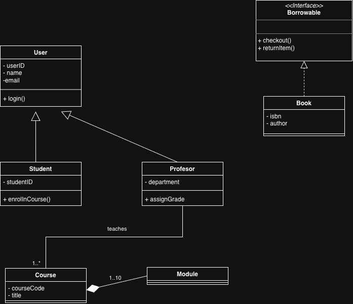

# Campus Library System — UML Class Diagram

A UML class diagram for the **Object-Oriented Programming** exercise at WBS Coding School. It models a campus system with users, courses, modules, and borrowable books.

## Diagram files

- [Editable diagram (.drawio)](campus-library-system.drawio)
- [Diagram preview (.png)](campus-library-system.drawio.png)

## Main relationships

- **Inheritance:** `Student` and `Professor` inherit from `User`.
- **Composition:** A `Course` owns 1–10 `Module` objects.
- **Association:** A `Professor` teaches one or more `Course` objects.
- **Interface implementation:** `Book` implements `Borrowable` with `checkout()` and `returnItem()`.

## Reflection: Why composition rather than inheritance?

Composition is a better choice because a `Course` **has** `Module` objects; a course **is not** a module. In this model, each module belongs to its course and cannot exist independently if that course is deleted. Inheritance would incorrectly suggest an “is-a” relationship instead of the required “part-of” relationship.
